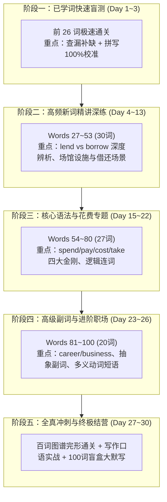

# 《KET 高频必默 100 词》30 天每日教学与通关计划（v2.0 优化版）

> **学情定制与教学依据**：
> - **学情反馈**：前 26 个单词已有基础 $\to$ 前期**快节奏复盘盲测**，压缩时长，重点攻克后 74 个新词与重难点语法。
> - **OpenMAIC 核心技能支撑**：
>   - `curriculum-planner`：系列课轻重缓急动态调优与分阶达成
>   - `spiral-curriculum`：布鲁纳螺旋上升，已知词作为新知识支架滚动出现
>   - `understanding-by-design` (UbD)：聚焦 KET 完形填空、短文写作与 100% 盲听默写标准
>   - `feynman-learning`：每日“以教代学”情境输出微任务

---

## 一、课程整体节奏与时间分配对比

- **节奏优化亮点**：
  - **前 3 天快速过筛**：前 26 词已学过，不再冗长单日慢讲，改为“快速认读 + 语境闪卡 + 盲测挑错”，摸清学员盲区；
  - **中段精讲空间大幅增加**：后 74 词每天仅精讲 3~4 词，配足真题语境、深度辨析与交互互动；
  - **周末保留螺旋复盘日**：每逢周日（Day 7, 14, 21, 27）进行阶段综合闯关，防止“学了后面忘了前面”。

---

## 二、OpenMAIC 单日教学场景标准形态（15~20 min）

每课基于 OpenMAIC 架构的多智能体交互模式：
1. **Scene 1: Spiral Warm-up（螺旋热身，3 min）**：智能助教出示闪卡，复习前序核心词汇发音与拼写。
2. **Scene 2: Contextual Masterclass（真题情境输入，6 min）**：主讲智能体以 1 个情境主题故事或 KET 真实对话带出当日新词，精讲**发音、词性、高频搭配、避坑提醒**。
3. **Scene 3: Deep Interactive / Quiz（深度辨析与交互微测，4 min）**：同反义辨析/句型选择（2 道精选真题题型）。
4. **Scene 4: Dictation Blitz（听音盲默挑战，4 min）**：听音辨字与句子挖空默写，彻底落实“必默”标准。
5. **Scene 5: Feynman Output（费曼表达应用，3 min）**：学员用所学词造句或解释生活情境，学伴智能体即时反馈润色。

---

## 三、30 天具体教学大纲（30-Day Syllabus）

### 阶段一：前 26 词快速复盘与盲听排雷（Day 1 ~ Day 3）

| 天数 | 课时主题 | 对应词汇（序号与单词） | 课时核心目标与实战能力 |
| :--- | :--- | :--- | :--- |
| **Day 1** | 情感与生活评价极速通关 | ① relaxing, ② disappointed, ③ pleased, ④ enjoyable, ⑤ comfortable, ⑥ amazing, ⑦ fabulous, ⑧ popular, ⑨ dull | **快速排雷**：-ed / -ing 形容词快速区分，反义对对碰（dull vs amazing），9 词盲听快写排查错别字 |
| **Day 2** | 特征、态度与观点辨析 | ⑩ fashionable, ⑪ sociable, ⑫ useful, ⑬ important, ⑭ awesome, ⑮ special, ⑯ fantastic, ⑰ cheap, ⑱ agree | **句型加深**：`It's important to do`, `agree with sb.` 表达训练；9 词听写盲测与长单词（fashionable, comfortable）拼写强化 |
| **Day 3** | 图案、支付方式与赛事闯关 | ⑲ disagree, ⑳ striped, ㉑ spotted, ㉒ warning, ㉓ credit card, ㉔ cash, ㉕ competition, ㉖ match | **场景实战**：支付问答（by credit card / in cash），比赛辨析（match/competition），**前 26 词阶段全盲测通关** |

---

### 阶段二：新词精讲——青少年、场馆设施与借还规则（Day 4 ~ Day 14）

| 天数 | 课时主题 | 对应词汇（序号与单词） | 课时核心目标与实战能力 |
| :--- | :--- | :--- | :--- |
| **Day 4** | 青少年与替代选择 | ㉗ teenager, ㉘ race, ㉙ instead | 掌握 `instead of + doing` 高频句式，辨析 race 与 match |
| **Day 5** | 场馆出入与门票服务 | ㉚ exit, ㉛ entry ticket, ㉜ lend | 掌握公共场馆标牌读法，初识 `lend sb. sth. / lend sth. to sb.` |
| **Day 6** | 借还双子星与可用状态 | ㉝ borrow, 㞞 available, ㉟ discount | **核心突破**：`borrow from` vs `lend to` 黄金辨析；打折问答 |
| **Day 7** | **Week 1 螺旋巩固课** | **复盘 Day 1~6（Words 1~35）** | **阶段闯关**：公共标牌匹配 + lend/borrow 专项选择 + 词汇拼写连击 |
| **Day 8** | 人群区域与场馆入口 | ㊱ adult, ㊲ area, ㊳ entrance | 掌握 adult ticket 与 child ticket 票务场景，entrance/exit 反义配对 |
| **Day 9** | 信息传递与校园成员 | ㊴ message, ㊵ offer, ㊶ pupil | 掌握 `take/leave a message` 与 `offer to help` 礼貌交际用语 |
| **Day 10** | 艺术展览与宣传广告 | ㊷ exhibition, ㊸ advertisement, ㊹ equipment | **拼写克星突破**：advertisement 音节拆分默写，equipment 不可数特性 |
| **Day 11** | 网络信息与荣誉出行 | ㊺ website, ㊻ prize, ㊼ coach | 掌握 `win the first prize` 与交通大巴 coach（多义拓展：教练） |
| **Day 12** | 建筑设施与状态包含 | ㊽ stairs, ㊾ broken, ㊿ include | 掌握 `go down the stairs` 与被动语态感知（is broken / are included） |
| **Day 13** | 借还闭环与员工服务 | 51. return, 52. staff, 53. receive | 掌握 `return sth. to the library` 完整闭环，receive 与 get 语境 |
| **Day 14** | **Week 2 螺旋巩固课** | **复盘 Day 8~13（Words 36~53）** | **阶段闯关**：场馆游览情境填空 + 易错词音频盲写挑战 |

---

### 阶段三：新词精讲——动词核心网、连词逻辑与四大花费（Day 15 ~ Day 22）

| 天数 | 课时主题 | 对应词汇（序号与单词） | 课时核心目标与实战能力 |
| :--- | :--- | :--- | :--- |
| **Day 15** | 学校项目与特别价格 | 54. project, 55. price, 56. special, 57. free | 掌握 `work on a project` 与 `for free`（免费）固定搭配 |
| **Day 16** | 日常习惯与解释说明 | 58. usual, 59. explain, 60. enough, 61. at least | 掌握 `explain sth. to sb.` 与 `enough` 形容词后置/名词前置规则 |
| **Day 17** | 售卖、建议与交际沟通 | 62. for sale, 63. suggest, 64. ask, 65. tell | 掌握 `for sale` vs `on sale`；`suggest doing` 经典考点 |
| **Day 18** | **KET 必考四大花费专项** | 66. spend, 67. pay, 68. cost, 69. take | **核心语法突破**：四大花费动词（sb. spend/pay vs sth. cost/take）四角转换公式实战 |
| **Day 19** | 伙伴邀请与时间转折连词 | 70. join, 71. as soon as, 72. although/though | 掌握 `join us for...` 与 `as soon as`“主将从现”时态搭配 |
| **Day 20** | 最终结局与未来安排 | 73. at last, 74. finally, 75. plan, 76. invite | 区分 at last 与 finally；掌握 `plan to do` 与 `invite sb. to my party` |
| **Day 21** | **Week 3 螺旋巩固课** | **复盘 Day 15~20（Words 54~76）** | **阶段闯关**：花费句型专项改错 + 连词造句微写作 + 听写过关 |
| **Day 22** | 聚会展出、到达与建议 | 77. show, 78. arrive, 79. collect, 80. advice | 区分 `arrive at`（小地点）与 `arrive in`（大地点）；advice 不可数考点 |

---

### 阶段四：高级词汇——职场探索、抽象副词与生活常识（Day 23 ~ Day 27）

| 天数 | 课时主题 | 对应词汇（序号与单词） | 课时核心目标与实战能力 |
| :--- | :--- | :--- | :--- |
| **Day 23** | 职业发展与技能提升 | 81. career, 82. business, 83. improve, 84. article, 85. company | 掌握 `improve English by doing`, company 多义（公司 vs 陪伴） |
| **Day 24** | 规划决断与深度探索 | 86. perhaps, 87. decide, 88. extra, 89. explore, 90. especially | 掌握 `decide to do`，especially 强化语气在写作中的妙用 |
| **Day 25** | 精准事实与立场信念 | 91. exactly, 92. against, 93. believe, 94. pick up, 95. even | 掌握 `against the rules`，动词短语 `pick up`（接人/捡起/顺路买）多义 |
| **Day 26** | 状态延续与安全服务 | 96. still, 97. quite, 98. several, 99. danger, 100. service | 辨析 still / quite / several 语义层级；掌握 `in danger` 警示短语 |
| **Day 27** | **Week 4 螺旋巩固课** | **复盘 Day 23~26（Words 81~100）** | **阶段闯关**：高级副词选词填空 + 职业/安全场景短文理解 + 拼写速记 |

---

### 阶段五：KET 全真冲刺、输出突破与终极通关（Day 28 ~ Day 30）

| 天数 | 课时主题 | 核心任务与形式 | 产出物与交付标准 |
| :--- | :--- | :--- | :--- |
| **Day 28** | **百词全景图谱与题型突围** | 100 词按“人际感受、公共生活、核心动词、逻辑副词”四大思维导图复盘，完成 3 篇 KET 阅读完形填空全景通关 | 形成学员个人专属高频错词排查清单 |
| **Day 29** | **KET 写作与口语高分输出课** | 提取 100 词高分词块（如 `especially, although, instead of, available, suggest`），指导完成 2 篇 35 词便条写作与口语考官模拟答题 | 产出高分作文范文与口语卡片 |
| **Day 30** | **百词终极盲盒默写 & 结营认证** | **100 词全真盲听听写大冲关**（由智能体随机抽取 100 词发音与句子挖空）+ 结营学情总结与通关勋章颁发 | 达成 100% 盲听盲写无误，生成永久复习归档卡 |

---

## 四、执行推进建议

- **第 1 步（确认计划）**：请确认当前 v2.0 优化方案是否完全符合您的预期。
- **第 2 步（课件生成）**：确认后，我们将按照 OpenMAIC 的教学规范开始生成对应课件内容（如 Day 1~3 的快速排雷课件，以及 Day 4 起的精讲互动微课）。
